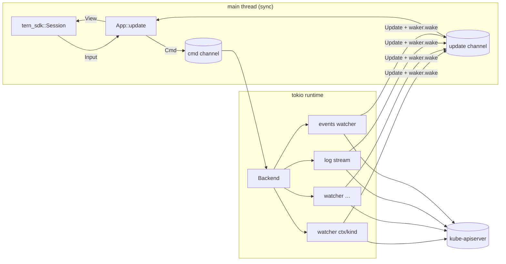

# tern-kube: plan

An Aptakube-style Kubernetes GUI for Tern. It is one native Rust program,
`tern-kube`, that keeps list+watch streams open to the API servers and draws
Tern's native UI through the Surface Protocol (TSP). A small Luau plugin opens
it from the palette.

## 1. Why this shape

Aptakube (checked in the installed app's binary and in the author's
statements) is Tauri plus `kube-rs`. It uses `kube-runtime`'s `watcher` with
backoff (list + watch, list only when watch is forbidden), keeps a
`resource_watchers` table, and sends `applied`/`deleted`/`restarted` events to
the UI. Logs are streamed by a log module that fetches recent lines first,
then follows. Each context is queried in parallel.

tern-kube copies that data path and swaps Tauri's web view for Tern's
native renderer (`tern-sdk` crate, TSP):

| Concern | Choice |
| --- | --- |
| Cluster access | `kube` 5 (`client`, `runtime`, rustls). Kubeconfig loading and exec credential plugins are handled in-process, never by `kubectl` |
| Data freshness | `kube::runtime::watcher` per (context, resource), all namespaces, backoff on errors. A namespaced watch is the fallback when cluster-wide list is forbidden |
| Warm caches | An LRU of up to 8 live watchers, so switching back to a kind is instant |
| Payload | `DynamicObject` for every kind, built-in or CRD. Each object is projected into a compact row once per change. Raw objects are kept for the detail view only |
| UI | `tern_sdk::Session`, screen surface, `Font::Sans`. Rendering happens on the main thread |
| Render cost | The rows prop is resent whole on every change (`reconcile.rs` sets whole props). Changes are batched: a render runs at most every 50–500 ms, scaled by row count |
| Logs | `Api<Pod>::log_stream` with follow and the last 500 lines, batched into an append-only `ansi` node. Append-only keeps the frame a suffix append |
| Shell / edit / port-forward | `tern split $TERN_PANE right -- kubectl …`, a real terminal pane |

## 2. Process model



- The main loop calls `session.next(timeout)`. A `Waker` interrupts it when
  updates arrive. Updates are drained, applied to the store, and the view is
  rendered once the render interval has passed.
- `Cmd`s: `Connect(ctx)`, `Watch(key)`, `Logs{…}`, `StopLogs`,
  `Events{uid}`, `StopEvents`.
- `Update`s: `Contexts`, `Discovered(ctx, kinds)`, `Watch(key, Applied |
  Deleted | InitStart | InitDone | Error)`, `LogLines`, `LogEnded`, `Events…`.

## 3. Layout

```
src/
  main.rs        startup, runtime, session loop, render batching
  app.rs         state, update(Msg), keys, merged contexts, dialogs, history
  backend.rs     Cmd/Update, per-context client cells, watches, logs, events, metrics polls
  kinds.rs       kind registry: sidebar groups, ApiResource, columns, capabilities
  rows.rs        Row model and per-kind projection (DynamicObject → cells)
  metrics.rs     Metrics API snapshots, quantities, requests/limits
  mutate.rs      scale, restart, delete, CronJob trigger/suspend, cordon
  portforward.rs local listeners → pod / service (re-resolved per connection)
  config.rs      change protection (protected / read-only contexts)
  filter.rs      filter grammar: AND words, `a|b` OR, `!x` NOT, `*` glob, `/re/`
  format.rs      ages, natural sort
  view.rs        sidebar, toolbar, table, detail tabs, logs, dialogs, dock
  actions.rs     tern split launches (shell, edit, logs -f)
plugin/
  plugin.toml    window-only plugin: id tern-kube
  window.luau    "Open Kubernetes" command + keybind → new tab running tern-kube
```

## 4. Milestones

All five are implemented.

1. **Browse:** contexts, namespaces, grouped kinds plus CRDs, live sortable/filterable tables, detail pane (Overview, YAML, Events, Logs), Shell/Edit/`logs -f` splits, launcher plugin.
2. **Actions:** scale, rollout restart, delete, CronJob trigger and suspend, cordon/uncordon. The confirmation names the context. Protected contexts need an unlock; read-only contexts refuse.
3. **Metrics:** `metrics.k8s.io` polled every 15 s; CPU and memory meter cells against limits or requests.
4. **Several contexts at once:** merged tables with a Context column and a context picker.
5. **Navigation:** back/forward, `g` jumps, owner links, child pods, aggregated workload logs, port-forward manager.

6. **Beyond Aptakube's basics (done):** Health page, ⌃K palette, bulk actions, in-place YAML editor with diff and conflict-safe apply, cross-context compare, Helm releases, Argo CD/Flux, CRD printer columns, Secret/ConfigMap views with TLS details, log filter/pause/timestamps, workload metrics, stale and sign-in states, node drain, debug containers, saved port forwards, context aliases/colors/tags, label columns, state saved on every change and reopen after restart.

## 5. Verification

- `cargo test`: projection per kind (fixtures from rancher-desktop), filter
  grammar, sort order, age and quantity formatting, render-interval math.
- Live check against **rancher-desktop only**:
  `tern ctl … plugins run plugin.tern-kube.open`, then `tree` and `shot`.

## 6. Risks

| Risk | Mitigation |
| --- | --- |
| Whole-rows resend on large tables | Batched renders with an interval scaled by row count; filters narrow the rows |
| Exec auth plugins (`tsh`, gcloud) not on the pane's PATH | The pane runs in the user's login shell; errors name the missing binary |
| Cluster-wide list forbidden | Fall back to a namespaced watch for the selected namespace |
| Daemon restart drops the screen | Reopen from the palette; watches re-list (Aptakube re-lists on launch too) |
| Expired credentials leave stale data (Aptakube #558) | Watcher errors switch the view to stale with the error shown in the dock |
