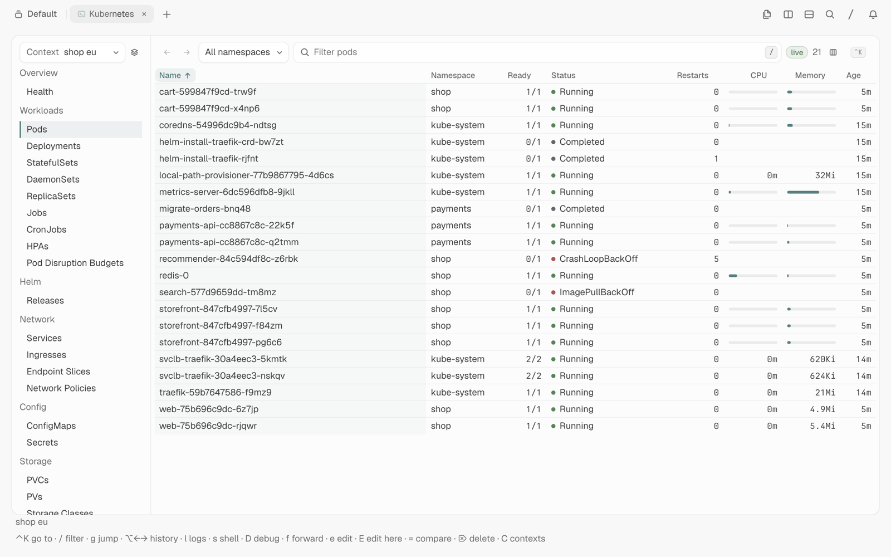
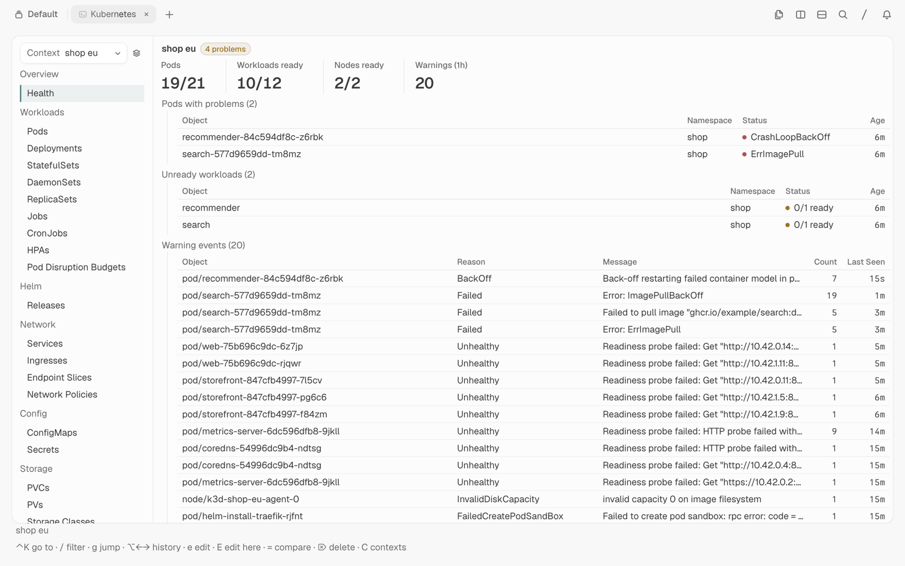
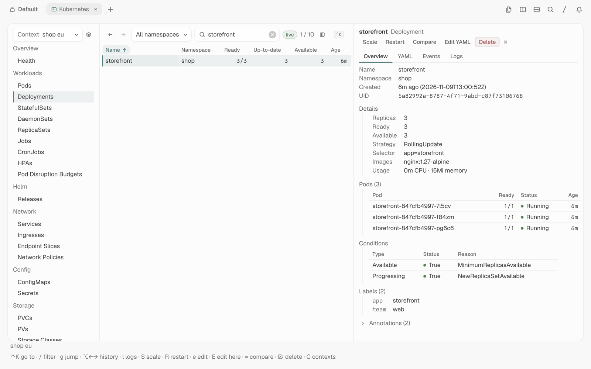
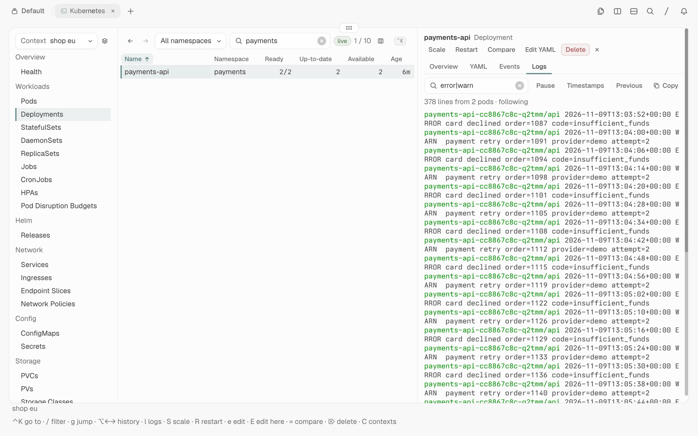
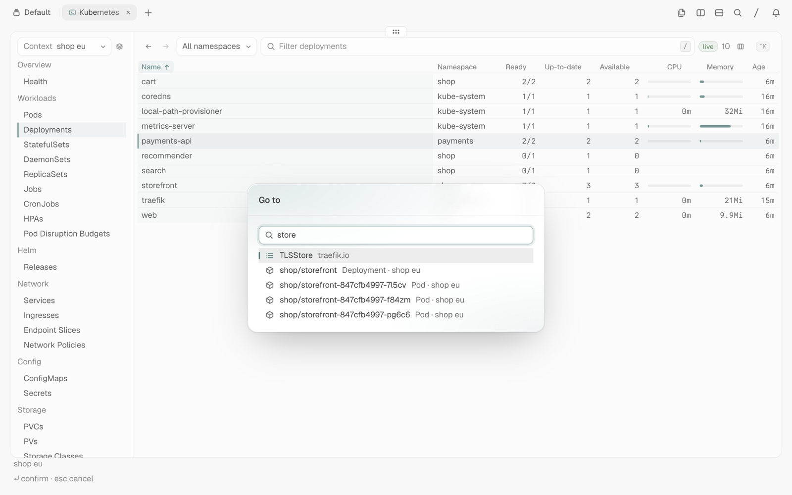
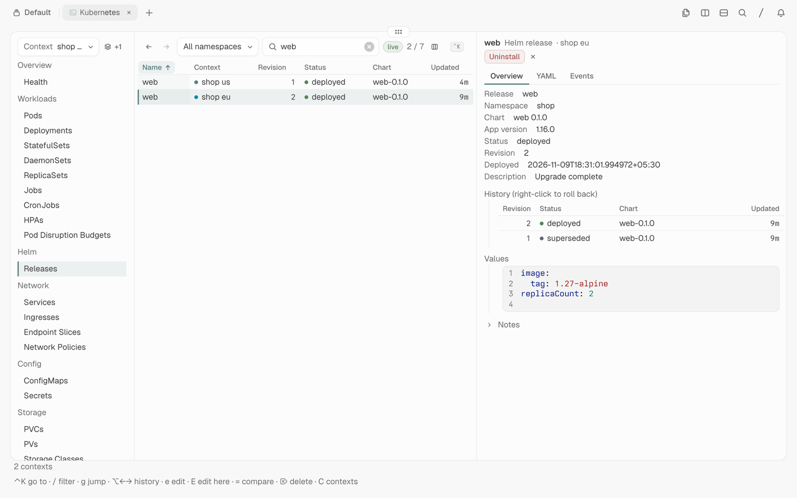

# tern-kube

`tern-kube` is a fast, native Kubernetes browser for [Tern](https://docs.stencil.so/tern/),
modeled on [Aptakube](https://aptakube.com).
It is a Rust program that draws Tern's native UI through the Tern Surface Protocol.
A small Tern plugin opens it from the command palette.



## How it works

- It reads your kubeconfig with `kube-rs` and talks to the API servers directly.
  Credential plugins such as `tsh` and `gke-gcloud-auth-plugin` run in-process, like kubectl runs them.
- Each list is a list+watch stream (`kube_runtime::watcher`), so tables update live without polling.
  The first list is served from the apiserver's watch cache.
- Recent watches stay open, so switching back to a kind is instant.
- Watch events are batched into one frame. A large table waits longer between frames, up to 500 ms.
- Each context gets its own client, created in the background.
  A slow sign-in in one cluster does not hold up another.
- It never changes your kubeconfig, and it runs no agent in the cluster.

## Screens

| | |
| --- | --- |
|  **Health:** problem pods, unready workloads, nodes, pending claims, failed jobs and the last hour's warnings, per context. |  **Detail:** a workload with its pods and summed usage, conditions and labels. |
|  **Logs:** streamed, filtered with the table's filter grammar, with timestamps, pause and copy. |  **Merged logs** of picked pods, across contexts, each line tagged with its pod. |
|  **Several clusters** in one table with aliases and colors; pick rows for bulk actions. |  **YAML editor:** edit in place, review the diff, apply. |
|  **Go to** (⌃K): kinds, actions and every loaded object. |  **Helm releases:** history, values, notes, rollback and uninstall. |

## Functions

- **Clusters**
  - One context, or several merged into one table with a Context column.
  - Context aliases, colors and tags; a tag shows all its contexts at once.
  - Namespace filter.
  - Change protection: protected contexts need a 15-minute unlock before changes, read-only contexts refuse them.
- **Resources**
  - Workloads: Pods, Deployments, StatefulSets, DaemonSets, ReplicaSets, Jobs, CronJobs, HPAs, Pod Disruption Budgets.
  - Helm releases (read from their secrets), Argo CD applications and Flux objects.
  - Network: Services, Ingresses, Endpoint Slices, Network Policies.
  - Config: ConfigMaps, Secrets.
  - Storage: PVCs, PVs, Storage Classes.
  - Cluster: Nodes, Namespaces, Events.
  - Access control: Service Accounts, Roles, Role Bindings, Cluster Roles, Cluster Role Bindings.
  - Every custom resource that discovery finds, with its CRD's printer columns.
- **Tables**
  - Live tables with sortable columns and kubectl-style status (for example `CrashLoopBackOff` or `Init:0/1`).
  - CPU and memory for pods, nodes and workloads (summed over their pods) from the Metrics API.
    Bars measure usage against the limit, else the request.
  - Label columns of your choice for each kind.
  - **Filter:**
    - Words must all match.
    - `a|b` matches either.
    - `!x` excludes.
    - `*` is a wildcard.
    - `/regex/` is a regular expression.
- **Detail pane**
  - **Overview:**
    - Metadata, owner links, kind details, containers, conditions, labels, annotations.
    - Child pods of workloads, services and nodes.
    - Secret values: hidden until revealed, copyable, with TLS certificate details.
    - ConfigMap values, highlighted per key.
  - **YAML:**
    - Copy.
    - Edit in place, review the diff, apply.
      The apply carries the version it started from, so a change made on the server meanwhile is refused instead of overwritten.
  - **Events:** live.
  - **Logs:** streamed; container picker, previous instance, timestamps, filter, pause and copy.
    Workloads and services merge the logs of their pods.
  - **Compare:** a diff against the same object in another context or namespace.
- **Actions** (right-click a row, detail buttons, or keys)
  - Scale, rollout restart and delete.
  - CronJob trigger, suspend and resume.
  - Node cordon, uncordon and drain (with progress and cancel).
  - Flux reconcile, Argo CD refresh.
  - Each one asks first and names the context.
  - Pick several rows to restart, scale, delete or merge their logs at once.
  - Shell, debug container, `kubectl edit`, `kubectl logs -f`, `helm rollback` and `helm uninstall` open in a real terminal split.
- **Port forwards**
  - Pods and services, with live status in the sidebar.
  - A service forward picks a ready pod for each new connection, so it follows pod replacements.
  - Forwards are saved and can be started again, one by one or all at once.
- **Staying current**
  - Watches that keep failing mark the data stale.
  - When credentials expired, **Sign in** runs kubectl in a terminal so the credential plugin can prompt.
    **Reconnect** then makes a fresh client.
- **Navigation**
  - Back and forward history.
  - `g` jumps to a kind.
  - ⌃K opens Go to.
  - Every view is saved as it changes, and the plugin reopens the tab after Tern restarts.

## Install

```sh
cargo install --path .        # puts tern-kube in ~/.cargo/bin
tern plugin link plugin       # the palette command, key bind and reopen-on-restart
```

Open the command palette and choose **Open Kubernetes**, or press `⌥⇧⌘K`.
You can also run `tern-kube` in any Tern pane:

```sh
tern-kube [--context NAME]... [--namespace NAME]
```

Give `--context` more than once to merge clusters.
Terminal actions call `kubectl` (and `helm` for releases), so they must be on the pane's `PATH`.
Everything else talks to the API servers directly.

## Configuration

`~/.config/tern-kube/config.json`:

```json
{
  "protected": ["*prod*"],
  "readonly": ["audit-*"],
  "unprotected": ["prod-sandbox"],
  "contexts": {
    "gke_acme_us-east4_frontend-production": { "alias": "frontend prod", "color": "red", "tags": ["prod", "gcp"] }
  }
}
```

- `protected`, `readonly` and `unprotected` are globs over context names. Matching ignores letter case.
  `unprotected` beats `readonly`, which beats `protected`.
  Without a file, every context with `prod` in its name is protected.
  RBAC still decides what your account may do.
- `alias` replaces the context name on screen only. Commands always use the real name.
- `color` is one of `red`, `orange`, `yellow`, `green`, `blue`, `purple` and `gray`.
- `tags` group contexts in the context picker.

The last view is saved in `~/.local/state/tern-kube/state.json`: contexts, kind, namespace, open object, port forwards and label columns.

## Keys

| Key | Function |
| --- | --- |
| ↑ ↓ / j k, PgUp PgDn, Home End | Select a row |
| Enter | Open the detail pane |
| Space | Pick the row (once a row is picked; Ctrl+Space starts) |
| Esc | Close a menu or dialog, clear picks, close the detail pane, or clear the filter |
| / | Filter |
| ⌃K or : | Go to |
| [ ] | Previous or next kind |
| g then h p d t a r j o l s i c x v n e | Health, Pods, Deployments, StatefulSets, DaemonSets, ReplicaSets, Jobs, CronJobs, Helm, Services, Ingresses, ConfigMaps, Secrets, PVCs, Nodes, Events |
| ⌥← ⌥→ | Back, forward |
| Tab, Shift+Tab, 1–4 | Detail tabs (y is YAML) |
| l | Logs |
| s | Shell into the pod |
| Shift+D | Debug container |
| f | Port forward (pods, services) |
| Shift+S | Scale |
| Shift+R | Rollout restart |
| t | Trigger the CronJob |
| e | `kubectl edit` in a split |
| Shift+E | Edit the YAML in place (⌃S reviews the diff) |
| = | Compare with another context or namespace |
| Delete, ⌘⌫ | Delete (the picked rows, if any) |
| Shift+C | Pick contexts |
| q, Ctrl+C | Quit |

## Development

```sh
cargo test
cargo build --release && cp target/release/tern-kube ~/.cargo/bin/
```

`PLAN.md` has the design.
